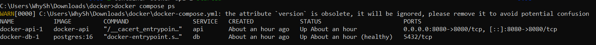
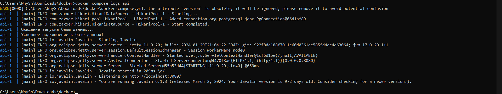
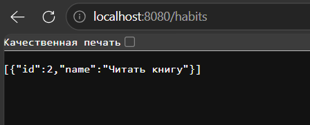

# Habit Tracker (Docker Compose + PostgreSQL)

Проект: трекер привычек. Реализован CRUD API на Java (Javalin) с использованием базы данных PostgreSQL.

## Запуск системы

### 1. Сборка и запуск
```bash
docker compose up -d --build
```
### 2. Проверка статуса контейнеров
```
docker compose ps
```
### 3. Проверка логов API
```
docker compose logs api
```
### Примеры CRUD-запросов (curl)
Создать привычку (POST): curl -X POST http://localhost:8080/habits -H "Content-Type: application/json" -d "{\"name\":\"Текст\"}"
Получить список (GET): curl http://localhost:8080/habit
Обновить привычку (PUT): curl -X PUT http://localhost:8080/habits/1 -H "Content-Type: application/json" -d "{\"name\":\"Читать 10 страниц\"}"
Удалить привычку (DELETE): curl -X DELETE http://localhost:8080/habits/1

### Проверка сохранения данных
```
docker compose down
```
```
docker compose up -d
```
После перезапуска все созданные привычки останутся в базе данных.

## Скрины




